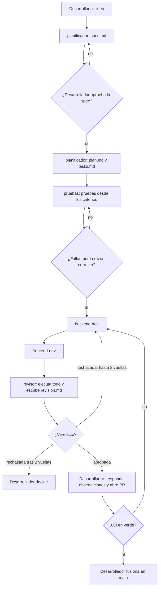

# Sistema de agentes · diseño inicial

Fecha: 11 de noviembre de 2026, antes de ejecutar la primera spec.
Este archivo no se edita después: los cambios posteriores se anotan en la sección 6 del `README.md`.

## Decisión: un sistema único

Solar-Grow es un monorepo y casi toda funcionalidad cruza backend y frontend (un endpoint y la
pantalla que lo consume). Por eso hay un solo sistema: planificar, probar y revisar se hace una vez
por spec, y solo la implementación se separa por stack, porque cambian el lenguaje, los comandos y
las reglas (pytest y SQLite en memoria frente a `flutter test` y providers falsos).

## Agentes

| Agente | Parte | Cuándo actúa | Recibe → entrega | Puede tocar | Herramientas | Modelo |
|---|---|---|---|---|---|---|
| Sesión principal (orquestador) | ambas | Siempre; la dirige el desarrollador | La solicitud → encargos a los agentes y resumen al desarrollador | Nada del código | Las de Claude Code | El de la sesión |
| `planificador` | ambas | Al inicio; lo invoca el orquestador | Una idea → `spec.md`, `plan.md`, `tasks.md` | `specs/**` | Read, Grep, Glob, Write, Edit | opus |
| `pruebas` | ambas | Con el plan aprobado, antes del código | La spec → pruebas en rojo | `backend/tests/**`, `frontend/test/**` | Read, Grep, Glob, Write, Edit, Bash | sonnet |
| `backend-dev` | backend | Después de `pruebas` | Tareas backend → código y pytest en verde | `backend/app/**` | Read, Grep, Glob, Write, Edit, Bash | sonnet |
| `frontend-dev` | frontend | Después de `backend-dev` | Tareas frontend → código y `flutter test` en verde | `frontend/lib/**` | Read, Grep, Glob, Write, Edit, Bash | sonnet |
| `revisor` | ambas | Al terminar la implementación | La rama → `revision.md` con veredicto | solo `specs/*/revision.md` | Read, Grep, Glob, Bash, Write | opus |

## Flujo

## Decisiones que quedan en manos de una persona

- Aprobar la spec antes de planear.
- Decidir si una prueba está mal (los implementadores no pueden modificarlas).
- Aceptar o descartar cada observación del revisor.
- Abrir y fusionar el pull request.

## Fuera del sistema

El firmware del ESP8266: controla una bomba real y no se puede compilar ni probar sin la placa, así
que ningún agente lo modifica.
